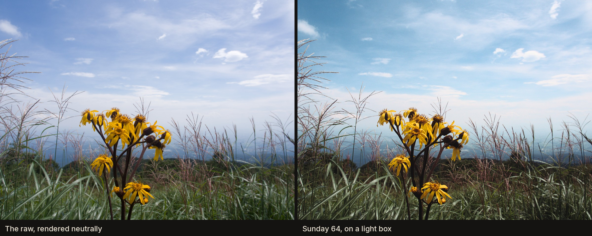

# Dyeroom

*Developed the long way.*



Dyeroom develops your digital photographs, raw files or phone pictures, on simulated film.
Not a preset laid over the picture: the light is exposed onto a modelled emulsion and taken
through the chemistry, step by step.

- **Sunday 64**, a colour slide film: three emulsion layers, a black-and-white first
  developer, re-exposure, three colour developers, bleach and fix, then the slide on a light
  box or a projector, rebuilt for your screen.
- **Monday 400**, a black-and-white negative: developed (pushed if you like), fixed, and
  enlarged onto graded paper, with selenium toning if you want it.

The films are built from their makers' published measurements and checked against them; what
is measured, what is fitted and what is assumed is written down in
[DEVELOPING.md](DEVELOPING.md).

## Try it

**[dyeroom.app](https://dyeroom.app)**: in the browser, nothing to install, free. Your
photographs are deleted when you leave.

## Run it on your computer

On macOS or Linux, in a terminal:

```sh
curl -LsSf https://dyeroom.app/install.sh | sh
```

On Windows, in PowerShell:

```powershell
powershell -ExecutionPolicy ByPass -c "irm https://dyeroom.app/install.ps1 | iex"
```

It installs [uv](https://docs.astral.sh/uv/), which brings its own Python, then Dyeroom, and
adds Dyeroom to your applications or the Start menu. Open it from there, or type `dyeroom`.
Your photographs stay on your computer: the lab runs there, uses all of it, and stops by itself
when you close its window. Nothing needs administrator rights or a signed installer.

```sh
dyeroom                      # open the lab (in an app window in Chrome, Edge or Brave if you have one)
dyeroom stop                 # stop it now
dyeroom colourise-model      # fetch the model that colourises black-and-white originals (270 MB)
dyeroom PHOTO.RAF            # or develop from the command line: a draft, into ./out
dyeroom --help
uv tool upgrade dyeroom      # update
```

With [ExifTool](https://exiftool.org) installed, exports keep the camera's metadata. To remove
it all: `uv tool uninstall dyeroom`, then delete Dyeroom from your applications and its folders
(`~/Library/Application Support/Dyeroom` and `~/Library/Caches/Dyeroom` on macOS,
`~/.local/share/dyeroom` and `~/.cache/dyeroom` on Linux, `%LOCALAPPDATA%\Dyeroom` on Windows,
where the Start menu entry is removed like any other).

From source, for working on it: [CONTRIBUTING.md](CONTRIBUTING.md).

## Support it

Dyeroom is free and stays free. If it is worth something to you,
[buy me a coffee](https://buymeacoffee.com/geoyanj).

## Contributing

Issues and pull requests are welcome; see [CONTRIBUTING.md](CONTRIBUTING.md). Contributions
are accepted under the [contributor agreement](CLA.md), which you sign with one comment on
your first pull request.

## Licence

Dyeroom is free software under the GNU Affero General Public License, version 3 or later
([LICENSE](LICENSE)): you may use, study, change and share it, also commercially, as long as
what you share, or run for others as a website, comes with its source under the same licence.

The licence covers the code, not the name: "Dyeroom" and its logo identify this project. A
changed copy you share or host needs a name of its own.

What Dyeroom is built from, and the licences of the data, models and software it uses:
[SOURCES.md](SOURCES.md).
